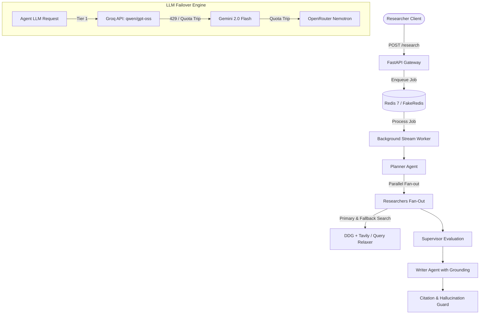

# Multi-Agent Research Assistant: 5-Phase Production Readiness & Deployment Plan

This document details the architecture, code modifications, testing strategy, and deployment configuration to bring the Multi-Agent Research Assistant to 100% enterprise production readiness.

---

## Architecture & Objectives Overview



---

## Phase 1: Dynamic Multi-Provider LLM Fallback Engine

### Objectives
Prevent rate limit blocks and daily token exhaustion by enabling automatic provider failover.

### Key Changes
1. **Extend `app/llm/client.py`**:
   - Introduce `fallback_providers: list[tuple[str, str]]` parameter or config.
   - If the primary provider (e.g. `groq`) fails with `RateLimitedError`, `AuthError` or quota exhaustion, transparently re-route the call to `gemini` (`gemini-2.0-flash`) or `openrouter` (`nvidia/nemotron-3.5-lightning:free`).
   - Settle token count and pricing against whichever provider fulfilled the request.
2. **Gemini / OpenRouter Provider Verification**:
   - Verify `GeminiProvider` and `OpenAIProvider` (used for OpenRouter and Grok) handle structured JSON responses cleanly and map correctly to Pydantic schemas.

---

## Phase 2: Search Engine Resilience & Smart Query Reformulation

### Objectives
Eliminate 0-finding queries (e.g., when DuckDuckGo rate-limits or returns zero results for technical queries like MARL).

### Key Changes
1. **Extend `app/tools/search.py`**:
   - When Tavily API key is provided, use Tavily as primary/fallback search tool.
   - When using DuckDuckGo, catch empty result sets and execute an automatic **Query Relaxation Step** (stripping noisy modifiers, punctuation, or dates like "2024").
2. **Researcher Sub-question Fallback**:
   - If search returns 0 snippets, fall back to broader academic terms instead of returning empty findings.

---

## Phase 3: Robust Schema Pre-Sanitization & Repair Guard

### Objectives
Eliminate schema repair exhaustion errors (`Schema repair attempts exceeded: 3 > limit 2`).

### Key Changes
1. **Extend `app/llm/client.py`**:
   - Add a robust JSON sanitizer before feeding raw text to Pydantic validation:
     - Remove markdown backticks (```json ... ```).
     - Trim trailing commas, leading/trailing whitespace, and escape rogue control characters (`\r`, unescaped newlines).
   - Only increment `budget_guard.record_repair_attempt()` if semantic repair is genuinely required, avoiding wasted attempts on trivial formatting issues.

---

## Phase 4: Frontend Polish & Researcher Experience

### Objectives
Equip the clean academic UI with researcher-grade productivity tools.

### Key Changes
1. **Citation Snippet / Excerpt Drawer**:
   - In `app/static/index.html` and `app.js`, enhance citation cards `[1]`, `[2]` with an interactive modal/popover displaying the exact extracted source quote and domain metadata.
2. **Export Options**:
   - Add **"Download Report (.md)"** button allowing researchers to export generated synthesis, summaries, and bibliography in Markdown format.
3. **Live Progress Step Indicators**:
   - Update the stepper to clearly show which sub-questions are currently in-flight.

---

## Phase 5: Docker Containerization & Production Deployment

### Objectives
Provide a turn-key, scalable deployment with official Redis 7 and healthcheck probes.

### Key Changes
1. **`Dockerfile`**:
   - Multi-stage or optimized Python 3.12 slim image.
2. **`docker-compose.yml`**:
   - Service 1: `redis` (Redis 7 Alpine, persistent volumes, password protected or localhost bind).
   - Service 2: `app` (FastAPI + Background Workers, connected via `REDIS_URL=redis://redis:6379/0`).
3. **Health Check Probes**:
   - Ensure `/metrics` and `/` respond with HTTP 200 for container orchestrators.

---

## Verification & Automated Test Plan

1. **Unit Testing (`pytest`)**:
   - `tests/unit/test_citation_validator.py`
   - New unit tests for multi-provider fallback logic.
   - New unit tests for JSON pre-sanitization.
2. **Integration & Automated End-to-End Run**:
   - Execute `auto_test_runner.py` across 3 distinct research topics:
     1. *"Solid-state battery breakthroughs in 2024"*
     2. *"Post-quantum cryptography NIST standards"*
     3. *"Recent developments in multi-agent reinforcement learning"*
   - Verify:
     - Status: `completed` (100% success rate across all 3).
     - Citation coverage: `1.0` (100% grounded citations).
     - Hallucinations: `0`.
     - Non-zero tokens and accurate USD cost calculations.
